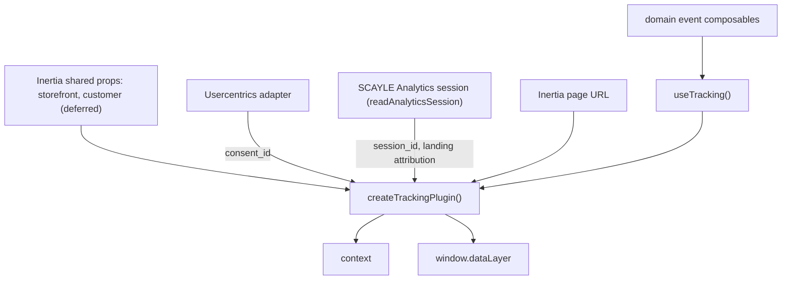

# Tracking

The SCAYLE Resource Center covers [Google Tag Manager](https://scayle.dev/documentation/storefront/storefront-application-v3/features/platform/analytics-and-tracking/google-tag-manager) and the [tracking events](https://scayle.dev/documentation/storefront/storefront-application-v3/features/platform/analytics-and-tracking/google-tag-manager/tracking-events) from the shop owner's side.

This document describes the GA4-aligned tracking implementation in Storefront Application V3: how the unified `context` object is built, how events are pushed to GTM, and how all event domains are organized across server, shared, and client layers. The event names, parameters and payloads follow the SCAYLE Analytics alignment of the Storefront tracking events: GA4 names where GA4 has one, the SCAYLE Analytics name otherwise, and each event fired by one source only.

---

## Tracking architecture

The browser builds the single `context` object in `createTrackingPlugin` from what it already holds: the `storefront` and `customer` shared props, the consent manager, `navigator.userAgent` and the SCAYLE Analytics browser session. The plugin also exposes the context of the current page as `useTracking().context`, which the checkout and sign-in pages pass to the SCAYLE web components as `tracking-context` (see [Checkout web components](SCAYLE-ANALYTICS.md#checkout-web-components)). The server contributes two values to those inputs and builds no tracking context of its own.

- **Server**: `CustomerMapperService` hashes the customer id into `customer.idHash`, and `storefront.config.ts` sets `version`, which reaches the browser as `storefront.config.version`.
- **Client**: captures the page fields when an event is pushed, holds the event until the deferred `customer` prop has resolved, then stamps the session and customer fields and pushes to `window.dataLayer`.
- **Shared types**: define the GA4 event and context contract.

### Overview flow



### Layer ownership

| Layer  | Path          | Responsibility                                      |
| ------ | ------------- | --------------------------------------------------- |
| Shared | `src/shared/` | Tracking contracts and event types                  |
| Server | `src/server/` | `customer.idHash` and `config.version`              |
| Client | `src/client/` | Build the whole `context` and push dataLayer events |

---

## Context model

Every tracking event carries a single `context` object. The plugin stamps its page fields when the event is captured and the rest when the event reaches the dataLayer, so a held event keeps the page it happened on and gets the session it is sent in.

### Stamped at capture

- `page_type`: `homepage` on the shop's start page, otherwise the snake_case mapping of the Inertia page component in `PageTypeSnakeCase` (e.g. `ProductDetail` -> `product_detail`). The account pages share `account`. The values are those of the SCAYLE Analytics context, and the same `resolveTrackingPageType` resolves both. `error`, `not_found` and `subscription_cancellation` are outside the listed SCAYLE Analytics values and pass as free-form strings.
- `page_path`: the current route path with the query keys on the tracking allowlist, for example `/de/c/shoes-5?page=2&sort=price_asc`. See [Tracked query keys](#tracked-query-keys).
- `previous_page_path`, `previous_page_type`: the previous `page_view`'s `page_path` and type, updated on each `page_view`.
- `page_type_id`, `page_location` and `page_title`: only on `page_view` events, as top-level keys next to `context`. `page_type_id` is derived from page props (`product.id`, `category.id`, `term`, `slug`, etc.). `page_location` is the address without its fragment and with only the query keys on the tracking allowlist, see [Tracked query keys](#tracked-query-keys).

### Stamped when the event reaches the dataLayer

- `consent_id`: the Usercentrics CMP controller id from the consent manager, an empty string until the CMP reports. Absent where the country requires no consent management (`consentManagementRequired: false`), since no consent platform runs there.
- `session_id`, `landing_page_path`, `utm_source`, `utm_medium`, `utm_campaign`, `utm_content`, `referrer`: from the SCAYLE Analytics browser session, read through `readAnalyticsSession()` in `src/client/plugins/analyticsSession.ts` without writing it. `session_id` is the session's id, `landing_page_path` the path the session started on, without query string and hash, the `utm_*` fields the values of that landing URL's query string, and `referrer` the external referrer of the session start, cut at its first `?` or `#`. The session starts in memory when the page loads, so these are set before SCAYLE Analytics consent and after a decline too. Consent decides only whether the session is stored: for a user who declined SCAYLE Analytics, every page load starts a new one. All of them are absent once a session ends, an hour after its last SCAYLE Analytics event or, when none was sent, after the page load, until the next page load or SCAYLE Analytics event starts a new one. A `utm_*` field is also absent when the landing URL had none.
- `user_id`: `customer.idHash`, the SHA-256 hash of the customer id (when logged in).
- `user_type`: `guest` without a customer, `new` while the customer is in the `new` group, `returning` otherwise.
- `login_state`: `logged_in` or `logged_out`. A guest checkout customer (`customer.isGuest`) is `logged_out` and carries no `user_id`, since it has no account.
- `customer_segment_<group>`: `true` for every group the customer belongs to.
- `device_type`: `ios`, `android`, or `desktop` derived from `navigator.userAgent`, with the classifier the SCAYLE Analytics dispatcher uses.
- `shop_country_id`, `country_code`, `locale`, `shop_currency`: from `storefront.country`.
- `shop_key`, `shop_version`: from `storefront.config` (`shop_version` is `config.version` in `storefront.config.ts`).

### Tracked query keys

A URL can carry a credential. The password reset link is `/signin?hash=<hash>`, the order success page reads its order from `?cbd=<token>`, an OAuth redirect can land on `#access_token=...`, and a CMS preview link carries preview parameters. GTM forwards what the plugin pushes to GA4, and SCAYLE Analytics stores `page_path` as analytics data. So the query string goes through an allowlist in `src/shared/utils/tracking.ts` before it reaches either: `toTrackedPath` builds `page_path`, the same value for GA4 and SCAYLE Analytics, and `toTrackedUrl` builds `page_location`. Both drop the fragment.

| Keys                                                                          | What they carry                                                                        |
| ----------------------------------------------------------------------------- | -------------------------------------------------------------------------------------- |
| `page`, `sort`                                                                | Pagination and sorting                                                                 |
| `filters[<slug>]`                                                             | The search term, the price and reduction bounds, and the attribute and boolean filters |
| `variantId`                                                                   | The selected variant on the product detail page                                        |
| `imageView`                                                                   | The image view of a listing                                                            |
| `register`                                                                    | The registration view of the sign-in page                                              |
| `utm_source`, `utm_medium`, `utm_campaign`, `utm_content`, `utm_term`         | Campaign attribution                                                                   |
| `gclid`, `dclid`, `gbraid`, `wbraid`, `fbclid`, `msclkid`, `twclid`, `ttclid` | Ad click ids                                                                           |

Every other key is dropped, among them `hash`, `cbd`, `transactionId`, `redirectUrl` (the auth guard puts the original path and its whole query into it) and the CMS preview keys. The list is an allowlist on purpose, because a denylist would miss the next credential key a shop adds. A shop that adds a query parameter of its own adds it to `TRACKED_QUERY_KEYS` once it carries no token, secret or personal identifier.

Kept pairs keep their order and repeats and are encoded again, so the brackets of `filters[color]` are reported as `%5B` and `%5D` and a space as `+`, and an encoded `&` or `=` inside a value cannot add pairs. The listing links write filters the same way, so `page_path` and `page_location` read like the address bar, and a link typed with plain brackets is reported encoded too. A GTM rule that matches a filter compares `filters%5Bterm%5D`, not `filters[term]`. When the query would take `page_path` over `ANALYTICS_MAX_PATH_LENGTH`, the length the analytics route accepts, `page_path` is the path alone.

`landing_page_path` stays the path without its query: the session reads only the four `utm_*` values from the landing URL. The `referrer` is cut at its first `?` or `#`, in the dataLayer and in the session. The `utm_*` keys of the referring page's own address attribute nothing to this session, and the cut keeps GA4 and SCAYLE Analytics on the same value.

Kept pairs are encoded again instead of cut out of the input, so a value such as `utm_source=a%26hash%3D1` stays one pair. A space in a value is reported as `+`, and a repeated key keeps every occurrence.

What this costs in reporting: the referrer loses its whole query. Browsers already send most cross-origin pages the origin only (the default `strict-origin-when-cross-origin`), and a referring site with a permissive policy can hand over a token.

A session stored by an older version of the Storefront Application keeps its unfiltered referrer until the session ends.

Three things stay outside the plugin's reach, because GTM and GA4 read the browser themselves:

- GTM built-in variables such as Page URL and Referrer, and the `page_referrer` a GA4 tag fills in by itself. The container has to take `page_location` from the dataLayer. The dataLayer holds no filtered referrer per page, so a tag that sends `page_referrer` has to clear it, or map `context.referrer`, which is the referrer of the session start and not of each page.
- The GTM History Change trigger. On every client-side navigation it pushes `gtm.oldUrl`, `gtm.newUrl` and `gtm.oldUrlFragment`, all unfiltered. It also pushes the Inertia history state, which the Storefront Application encrypts, so it is of no use to a tag. The plugin already fires `page_view` per navigation, so a container has no need for this trigger. Leave it out, or keep those variables out of every tag.
- A path segment that holds a token. The path is reported as it is.

---

## Event push pipeline

All event emitters call `useTracking().push(...)`.

`useTracking` delegates to the tracking plugin, which:

1. Guards server usage (`typeof window === 'undefined'`).
2. Captures the page fields and queues the event.
3. Waits for the deferred `customer` prop: `undefined` until its request resolves, `null` once signed out. No event reaches the dataLayer without the customer fields of its session.
4. Builds the rest of the `context` once per drain and merges it under each queued event.
5. Clears stale ecommerce data (`{ ecommerce: null }`) before pushes that contain `ecommerce`.
6. Pushes the final object to `window.dataLayer`.

This keeps payload formatting and context merge logic in one place.

---

## When GTM loads

The document head carries no GTM script. The `setup` of `SFAnalyticsHead.vue` calls `loadGtmWhenIdle` in `src/client/utils/gtmBootstrap.ts`, which hands the `gtm.js` script to `requestIdleCallback` with `GTM_LOAD_DEADLINE_MS` (2 seconds) as its timeout. That `setup` runs inside the task that hydrates the app, and an idle callback only runs between tasks, even once its timeout has passed. So GTM loads after hydration: the next time the browser is idle, or right after the hydration task when hydration takes longer than 2 seconds. A browser without `requestIdleCallback` waits the full 2 seconds. Loaded from the head, GTM and the tags it pulls in, such as GA4, download and run while the browser is still loading and hydrating the page, which pushes back LCP and hydration on mobile.

No event pushed before GTM loads is lost. `main.ts` pushes the `gtm.js` event as the first entry of `window.dataLayer`, the tracking plugin pushes its events behind it, and GTM works through the whole queue in order once it loads. The Usercentrics loader stays in the document head, so the consent banner shows as early as before. When Usercentrics is set up for Google Consent Mode, the consent commands it pushes wait in the dataLayer like any other entry, and GA4 hits carry the same consent state. SCAYLE Analytics sends its events without GTM, so its reporting does not change.

Check your container setup against these consequences:

- Tags and container triggers start later. Click, scroll, element visibility and timer triggers see nothing that happened before GTM loaded.
- `gtm.dom` and `gtm.load`, behind the DOM Ready and Window Loaded triggers, fire right after GTM loads, which can be after the first `page_view` in the queue. A tag that has to run before the first `page_view` belongs on the Initialization or Consent Initialization trigger.
- A user who leaves before GTM loads is not reported to GA4.
- GTM does not load when hydration never starts, for example when the page component's chunk or the locale messages fail to load.

Raise `GTM_LOAD_DEADLINE_MS` to keep GTM out of more of the work that follows hydration, or lower it to start your tags sooner.

---

## Navigation baseline: `page_view`

`page_view` is the navigation baseline and does not require page-level manual wiring.

### Lifecycle

1. Client installs `createTrackingPlugin`.
2. Inertia assigns the initial page, and the plugin captures the initial `page_view`.
3. The deferred `customer` prop resolves, and the plugin pushes the queued events.
4. The plugin watches the Inertia page URL, which moves on every visit, on a visit served from the prefetch cache, on a partial reload that moves the URL (PLP pagination, filters and sorting) and on browser back and forward. When the URL changes, it shifts current page data to previous page data and pushes a new `page_view`. A partial reload that keeps the URL (deferred props) pushes nothing, and neither does a change of the `imageView` query key alone, which only reorders the tiles a listing already shows. The SCAYLE Analytics `view_page` follows the same rule from its own watch. A visit that does not move the page, because it was cancelled or answered with an error, pushes nothing.
5. A `prefetch-on-press` link fetches its target on press without changing the page URL, so a press or a long tap pushes nothing. The plugin does not listen to Inertia's `finish` event for this reason: a prefetch fires it without leaving the page, and a visit served from the prefetch cache arrives without one.

The 404 page takes part like any other page: the SDK not-found handler (`createStorefrontNotFoundHandler()`) answers the partial reloads of its deferred props with `200`, so `customer` arrives and a `page_view` with `page_type: not_found` fires.

This ensures page-view tracking remains consistent with Inertia navigation behavior.

---

## GA4 event list

Tracking events are grouped by domain composables in `src/client/composables/tracking/`. Only the GA4-aligned events listed below are pushed to the data layer. The SCAYLE Analytics events the same composables fire are listed in the [SCAYLE Analytics event list](#scayle-analytics-event-list).

### Global and navigation (`useGlobalEvents`)

- `page_view`

### Basket (`useBasketEvents`)

- `add_to_cart`
- `remove_from_cart`
- `view_cart`
- `begin_checkout`
- `add_shipping_info`
- `add_payment_info`

All six carry the event-level `currency` and `value`. `quantity` on `add_to_cart` and `remove_from_cart` is the delta of the interaction, the units added or removed; on `view_cart` and the three checkout events it is the line quantity. `add_to_cart` fires after an add from the PDP and from the gift selection pop-up, and both fire on a quantity change on the basket page. `view_cart` fires when the basket page mounts. The Storefront Application has no basket preview flyout; a shop that adds one calls `trackViewBasket` when it opens.

`begin_checkout` fires once when the checkout page mounts, as soon as the deferred `basket` prop has resolved, because the checkout web component sends none. It reports the available lines only, since unavailable lines cannot be ordered, and `coupon` with the applied promotion codes, comma-separated, when the basket has any. A basket without available lines fires nothing, and neither does a failed basket fetch, which leaves the prop `null` while the web component still renders its own basket. `add_shipping_info` and `add_payment_info` carry the same items, `value` and `coupon` for the same basket; the [checkout bridge](#checkout-bridge-usecheckouttracking) fires them. `purchase` is fired by the Storefront on the order success page (see [Purchase](#purchase-useorderevents)).

### Product and discovery (`useProductEvents`)

- `view_item`
- `view_item_list`
- `select_item`

`view_item_list` fires once per list, not on pagination, filter reloads or per row, with the products of the page it renders: on the product listing, the search results page, the wishlist page, the product sliders, the single product spotlight and the gift selection. `select_item` fires on a product click from any of them and on the plus button of a gift selection reward, which opens a product pop-up. Both carry `item_list_name`, and `item_list_id` where the list has an id, at event level and on every item, see [List fields](#list-fields).

### Search (`useSearchEvents`)

- `search`

`search` carries the same payload as the SCAYLE Analytics `search`, from the same call to `trackSearchOutcome`: `search_term`, `search_destination_type` (`term`, `category`, `product` or `navigation_item`), `search_destination_url`, and, depending on the destination, `search_destination_id` (category, product, navigation item), `search_destination_filter_groups` (a category with filters) and `search_result_count` (the search results page). It fires when the search results page mounts and when `SFSearchField` resolves the term to a category, product or navigation item, not on pagination or filter reloads, and not again when browser history restores the results. It does not fire for a term the search provider rejects as too long, since no search ran.

### Wishlist (`useWishlistEvents`)

- `add_to_wishlist`

`add_to_wishlist` carries the event-level `currency` and `value`, and the item carries the surface it was added from as `item_list_name` and `item_list_id`, each where the surface has a value for it. `wishlist` and `remove_from_wishlist` are no longer emitted because they are not part of the GA4 standard.

### Promotion (`usePromotionEvents`)

- `view_promotion`
- `select_promotion`

These events carry top-level `promotion_id` and `promotion_name` fields instead of nested `ecommerce.items`.

### Auth (`useAuthEvents`)

- `login`
- `sign_up`

Both are pushed once the `customer` prop has refreshed after sign-in, so they carry the signed-in customer fields: `login_state: 'logged_in'` and `user_id`. The checkout web components never post them to the page, so the Storefront Application fires them.

The Storefront Application fires them for the SCAYLE Checkout auth flows, from the `auth:success` listener in `useCheckoutWebComponent`, on the sign-in page and in the checkout alike. A custom sign-in or registration surface, such as an SSO callback, calls `trackLogin(method)` or `trackSignUp(method)` from `useAuthEvents` itself. `method` is the GA4 `method` parameter and defaults to `email`.

`logout`, `forgot_password`, `reset_password`, and `guest_login` are no longer emitted.

### Checkout bridge (`useCheckoutTracking`)

The checkout web-component bridge forwards four events from the embedded checkout:

- `add_to_cart` and `remove_from_cart`, for basket changes made inside the checkout. The `basket` prop reloads after each.
- `add_shipping_info`, when the shipping step is completed, with `shipping_tier`.
- `add_payment_info`, when a payment method is selected, with `payment_type`.

Keep **Send Data Layer Events** disabled for the checkout web components in the SCAYLE Panel. With it enabled, the web components push their events to the `dataLayer` themselves. The events the bridge forwards then count twice, the push has no consent check, and the items keep the legacy fields. The web components post `login` and `sign_up` only to the `dataLayer`, never to the page, which is why the Storefront Application fires them.

Every event is fired by exactly one source, so the bridge drops every other event the web components post. The Storefront Application fires `begin_checkout`, `purchase`, `login` and `sign_up` itself.

`add_shipping_info` and `add_payment_info` are built from the `basket` prop by `useBasketEvents`, the same way as `begin_checkout`: the available lines, `value` from the basket total, and `coupon` with the applied promotion codes. The web component reports item prices without tax and promotion, so its items would put a second price for the same basket into the funnel. Only `shipping_tier` and `payment_type` come from the web component. The web component carries no `correlation_id` on either event, so the bridge deduplicates them per checkout page visit itself. `add_shipping_info` fires once, so a changed shipping choice is not reported again. The web component posts `add_payment_info` on every payment method click, and it fires once per payment method: a user who clicks PayPal and then pays by card reports both methods, and returning to PayPal reports nothing new. A step reported before the deferred `basket` prop resolves, or while the basket has no available lines, is dropped, and the next report of it is forwarded.

For the cart events, the legacy `page` and `session` objects are stripped from forwarded payloads so the plugin can inject the canonical `context`. Every entry in `ecommerce.items[]` is rebuilt down to the [GA4 item schema](#ecommerce-item-schema), dropping the web component's legacy item fields (`price_with_tax`, `item_brand_id`, `item_category_id`, `item_product_reference_key`, `sale`, ...) and coercing the string `quantity` the web component reports to a number. The web component reports `currency` and `value` inside its `ecommerce` block; the bridge hoists both to the event level GA4 reads them from and fills a missing `currency` from the shop context. A cart event whose event name and `correlation_id` were already forwarded on this checkout page visit is dropped.

### Purchase (`useOrderEvents`)

`purchase` fires when the order success page mounts with an order, once per order and browser tab, because a reload, a revisit or a back navigation mounts the page again. `useOrderEvents` first waits up to 5 seconds for the consent platform's first report, because consent reads `false` on a full page load until Usercentrics reports. It then remembers the sent order ids in session storage, but only with `google-analytics` consent, because session storage is device storage. Without consent nothing is stored and every mount pushes the event. Another tab or a cleared session storage sends the event again, so a consumer that counts revenue still deduplicates on `transaction_id`. The empty state fires nothing. The payload follows the GA4 purchase shape, with the SCAYLE Analytics extras at event level: `total_sale_discount`, `total_campaign_discount`, `total_promotions_discount`, `payment_method`, `carrier` and `delivery_option`. Money is decimal currency units. The three discount totals are the sums of the sale, campaign and promotion reductions on the order items. `payment_method` is the first payment key, `carrier` the first delivery's carrier, and `delivery_option` the first delivery fee's option; each is omitted when the order has none. The Checkout order payload has no promotion code, so `coupon` is omitted. Order lines have no category trail, so items omit `item_category`.

---

## SCAYLE Analytics event list

The same composables fire the SCAYLE Analytics events through `useAnalytics()`, next to the GA4 call at the call site; nothing links the two pipelines. The one exception is `view_page`, which the dispatcher in `src/client/plugins/analytics.ts` fires itself on every URL change, query string included, so PLP pagination, filters and the `?register=true` registration view each count where the GA4 `page_view` skips them (see [SCAYLE Analytics, Page views](./SCAYLE-ANALYTICS.md#page-views)). The dispatcher also owns the consent gate and posts to `POST /api/analytics/events`, one request per event. The route forwards each event to the Storefront API as it arrives, with no retries and no rate limiting in the application. A per-client rate limit on `POST /api/analytics/events` belongs at the CDN or WAF in front of the deployment.

### Global and navigation (`analytics.ts`)

- `view_page`, on every URL change including query-only changes, fired by the dispatcher rather than `useGlobalEvents`

### Product and discovery (`useProductEvents`)

- `view_product_list`, once per list with products: grid mount, category switch, first slider visibility, first visibility of a gift promotion's reward panel, every open of the add-to-basket confirmation (its recommendations are the trending products and report as `product_slider` / `trending`, like the PDP slider they duplicate)
- `view_product_tile`, per product tile, with its position across all pages and the list total
- `select_product`, on a product tile click and on the plus button of a gift promotion reward, which opens the selection pop-up instead of a detail page
- `view_product_detail`
- `apply_filter`, from `useFilter` once the filter reload succeeded, one per added or removed filter value. A reset (the reset-all button, the reset button of the no-results messages, or the reset of an attribute group with several values) reports one `remove` per cleared value, each with the filter state after the whole reset. Filters a page opens with, such as a pre-filtered category link, report no `add`, since no filter interaction happened, so a later `remove` of such a value has no matching `add`

### Search (`useSearchEvents`)

- `search`, the outcome of a submitted search: the search results page reports the `term` destination with its result count once on mount (not on pagination or filter reloads, not again when browser history restores the results, and not for a term the search provider rejects as too long, since no search ran), and `SFSearchField` reports a resolved category, product or navigation item before navigating there. `search_destination_url` is the link with the country prefix in both cases. A search the server resolves itself (direct URL entry, a form submit without JavaScript) is not reported: the browser lands on the resolved page, and neither the search field nor the search results page mounts to fire it
- `view_search_suggestion`, once per suggestion when the dropdown renders a suggestions result it has not reported yet; re-opening on the same result repeats nothing, and "show all results" is not a suggestion
- `select_search_suggestion`, on a suggestion click or an Enter on the active suggestion; "show all results" is excluded. Both suggestion events report the link with the country prefix as `suggestion_url`, and skip a suggestion whose link exceeds the analytics route's path limit with that prefix, since `suggestion_url` is required and the route would refuse the event

### Promotion (`usePromotionEvents`)

- `view_promotion`, when a deal banner or the layout ribbon first becomes visible, once per deal per page view (the guard resets when the page path changes, so partial reloads, pagination and filter changes keep it spent; a deal that stays in view across a navigation re-reports once it leaves and re-enters the viewport)
- `select_promotion`, on a click of a deal that carries a link

Both carry the placement the surface declares (`component_type`, `position`, `total`): the campaign banner counts as the first deal on the PDP, the basket and the deals overview, and the single layout ribbon reports `ribbon`, `1` of `1`.

### Basket (`useBasketEvents`)

- `add_to_basket`, next to `add_to_cart`: after a successful add from the PDP or the gift selection pop-up, after a quantity increase on the basket page, and for the new variant after a size change on the basket page
- `remove_from_basket`, next to `remove_from_cart`: after a confirmed removal on the basket page, after a quantity decrease, and for the old line after a size change
- `view_basket`, next to `view_cart`: once when the basket page mounts, with the basket total, the sale, campaign and promotion reduction sums the basket mapper computes, and every line with its quantity and 1-based `position`

`quantity` on `add_to_basket` and `remove_from_basket` is the delta of the interaction, not the resulting line quantity: raising a line from two to three units reports `1`, a full removal reports the whole line. When the Storefront API caps an add or an increase at the available stock, the event reports the units the basket actually gained, read from the reloaded basket, not the requested quantity. `useBasket().updateItemQuantity` fires the quantity-change events itself, the add and remove mutations leave the event to their caller, so every interaction has exactly one call site and the two pipelines cannot drift apart. A size change has no event of its own: `useBasket().changeItemVariant` reports it as `remove_from_basket` for the old line followed by `add_to_basket` for the new variant, same `product_id`, different `variant_id`, both on the `basket` surface. The remove carries the old line's quantity and the add the units the new variant gained, read from the reloaded basket, so a change the Storefront API capped at stock reports the smaller number. When the old line is still in the reloaded basket (the server keeps the add when the remove of the old line fails) only the add is reported. `promotion_ids` lists the promotions applied to the line; `add_to_basket` reads them from the basket prop the mutation reloaded before it resolved. The surface is `null` for the main PDP item, `gift_selection` with the promotion id for the gift pop-up, and `basket` with a `null` id for quantity changes and removals on the basket page.

### Wishlist (`useWishlistEvents`)

- `add_to_wishlist`, next to the GA4 event of the same name, after the toggle mutation confirms the add

`SFWishlistToggle` takes the surface as props (`productListType`, optional `productListId`) that every host declares: `SFProductCard` forwards the list type and id of its grid, slider or the wishlist page, the basket card passes `basket`, the gift pop-up passes `gift_selection` with the promotion id, and the PDP passes `null` because the closed vocabulary has no product detail surface.

---

## Ecommerce item schema

Ecommerce events carry an `ecommerce.items` array that follows the GA4 item schema.

```typescript
interface TrackingEcommerceItem {
  item_id: string
  item_name: string
  item_brand?: string
  item_category?: string
  item_category2?: string
  item_category3?: string
  item_category4?: string
  item_category5?: string
  item_variant_id?: string
  item_variant?: string
  quantity?: number
  price?: number
  discount?: number
  index?: number
  coupon?: string
  affiliation?: string
  item_list_id?: string
  item_list_name?: string
}
```

Money is in decimal currency units (`119.9`), as GA4 expects. SCAYLE Analytics reports the same amounts in integer minor units.

Key changes from the previous Storefront tracking concept:

- Consolidated `discount` field replaces `sale_discount_with_tax`, `campaign_discount_with_tax`, and `promotion_discount_with_tax`.
- `item_variant_id` and `item_variant` replace `item_size` and raw variant identifiers.
- `price` replaces `price_with_tax`.
- Brand and category IDs are removed; only category names are forwarded.
- The `promotions` array and `sold_out` flag are removed from item payloads.
- `index` is 1-based for GA4.
- `quantity` is left out on view and select events and on `add_to_wishlist`.
- `item_list_name` is added on list-context events, and `item_list_id` where the list has an id, see [List fields](#list-fields).

### List fields

GA4 names a list the way SCAYLE Analytics names its surface, so a GA4 list reads like the SCAYLE Analytics list it pairs with. `mapSurfaceToItemList` in `src/client/utils/tracking.ts` maps one onto the other:

| GA4              | SCAYLE Analytics    | Values                                                                                                                       |
| ---------------- | ------------------- | ---------------------------------------------------------------------------------------------------------------------------- |
| `item_list_name` | `product_list_type` | `category`, `search_results`, `product_slider`, `gift_selection`, `basket`, `wishlist`                                       |
| `item_list_id`   | `product_list_id`   | The category id, the search term, the slider id (`similar_products`, `recently_viewed`, `trending`) or the gift promotion id |

`item_list_id` is absent for a list without an id: the wishlist, a CMS product slider and the single product spotlight. GA4 cannot tell two CMS product sliders on one page apart, since both report only `item_list_name: 'product_slider'`.

The add-to-basket confirmation is the one list whose GA4 id differs from its SCAYLE Analytics id. SCAYLE Analytics reports its recommendations as the `trending` slider, like the PDP slider it opens over, since both show the trending products. In GA4 that would report one list twice for a single add, with the same products at the same positions, so `view_item_list` and `select_item` carry `item_list_id: 'add_to_basket_recommendations'` next to `item_list_name: 'product_slider'`. `TrackingItemListIds` in `src/shared/types/Tracking.ts` holds the GA4-only ids, and `SFProductSlider` and `useProductSliderTracking` take one as `itemListId`.

### Basket items

`mapBasketItemToTracking` maps a basket line to the GA4 item schema. The per-unit price and discount are read from the basket item's `unitPrice`.

### Product and discovery items

`mapProductForTracking` and `mapVariantForTracking` map listing and PDP products to the GA4 item schema. The first five breadcrumb levels are mapped to `item_category` through `item_category5`.

### Promotion events

Promotion events do not use `ecommerce.items`. Instead, they carry `promotion_id` and `promotion_name` directly on the event payload.

---

## Visibility driven impressions

List impressions fire once per list; tile impressions and `view_promotion` use visibility observers.

- `useProductEvents.trackViewItemList` fires the GA4 `view_item_list` and the SCAYLE Analytics `view_product_list` together, once per list with products.
- Grids (`useProductListTracking`) fire it when they first render products and again only when the list id changes, which covers a category switch that keeps the page component alive. Pagination and filter reloads keep the id and stay silent. The GA4 items are the products of the rendered page, with page-relative indexes.
- Sliders fire it when the slider container becomes visible, and the single product spotlight when 30% of it is on screen, together with its one `view_product_tile`. The spotlight is a full-width card that can be taller than twice the viewport, so half of it may never be visible at once.
- `SFGiftPromotionProducts` fires it when half of its reward panel is on screen, as the `gift_selection` surface, together with one `view_product_tile` per reward. The panel is one card with a handful of stacked rewards, so it does not observe each tile on its own.
- Product cards emit `intersectProduct` once half of the card is on screen (`useElementVisibility(..., { once: true, threshold: 0.5 })`), so a card that only touches the viewport edge or sits clipped at the end of a slider does not count. Grids and sliders fire `trackViewProductTile` for that one card. A grid reports its list-wide position, counted across pages with `toListIndex` in `useProductListTracking`. GA4 has no per-tile event.

---

## Consent ID

The `consent_id` field is populated from the Usercentrics CMP controller ID.

1. `createUserCentricsAdapterPlugin` listens for the `UC_CONSENT` event.
2. When the event fires, it calls `window.UC_UI.getControllerId()` (when available) and stores the value on the consent manager plugin as `consentId`.
3. `createTrackingPlugin` reads `consentId` whenever it pushes an event and sets it on the context, an empty string until then.

This ensures the consent ID is only available on the client and is captured after the user has interacted with the CMP.

## SCAYLE Analytics consent

The SCAYLE Analytics dispatcher (`src/client/plugins/analytics.ts`) has its own gate, separate from the GA4 pipeline and on its own vendor. An event is sent only while the consent manager reports the `scayle-analytics` vendor from `src/client/consent-vendor.config.json` as consented and holds a consent id; the Usercentrics adapter sets both in one step. Events captured while the CMP is still loading are held and then sent or discarded on its first report. Nothing is sent before consent, and an event captured against a decision the CMP has already reported is dropped rather than held. Where the country requires no consent management, events fire without a consent id.

`src/client/consent-vendor.config.json` ships the boilerplate Usercentrics mapping for SCAYLE analytics consent:

```json
"scayle-analytics": "HC1xyTERb1NJU_"
```

Replace that value with the service id your CMP assigns to SCAYLE Analytics (in Usercentrics, the id shown for that service in your configuration). The consent manager matches CMP consent events against this id; until it matches a vendor your CMP actually reports as granted, the gate stays closed in every country that requires consent management. Updating the entry is part of wiring your CMP. The steps, the consent behavior and how to verify events are flowing are documented in [SCAYLE Analytics](./SCAYLE-ANALYTICS.md).
